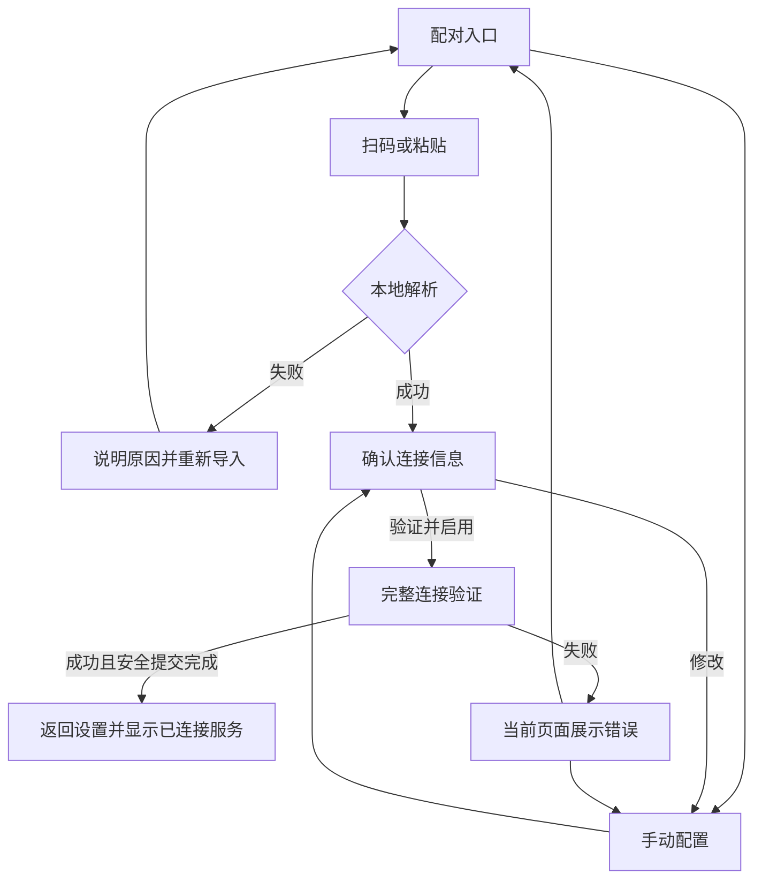

# 自建服务配对体验设计

日期：2026-09-27
关联需求：[Issue #14：自建服务端配对流程优化](https://github.com/Pixel-Tailor-CN/PixelTelo/issues/14)
状态：用户已确认完整设计，进入实施阶段。

## 1. 目标与依据

服务端已经提供配对 JSON、二维码与单项复制。App 将目前逐项填写地址、Token、TLS 模式及 Pin 的流程，优化为「导入配置 → 确认 → 验证并启用」。

覆盖两种常见场景：

- 在手机上打开服务端页面：复制整段 JSON，切回 App 粘贴导入。
- 在电脑或另一台设备上打开服务端页面：使用 App 内扫码导入。

仍保留手动配置，以便处理无法复制或扫码的场景。

需求来源为 Issue 标题、用户说明和本地保存的服务端配对网页。Issue 没有正文或评论。网页含实际凭据，不能复制进仓库、文档、日志或联调样例。

### 已确认的产品方向

- 使用独立配对页面，顶部提供扫码和粘贴入口，下方提供手动配置入口。
- 导入后展示服务地址、证书验证方式和令牌读取状态。
- 用户点击「验证并启用」后才发起完整验证并切换服务。
- 验证中和失败反馈留在当前页面，成功后返回设置页并展示已连接服务。
- 现有弹窗仅用于已配置服务的管理。

本文中的输入校验、生命周期处理和权限降级是支持上述方向的实现约束，不扩展为新的服务端协议。

## 2. 配对数据协议

服务端页面中的实际结构如下，示例不包含真实凭据：

```json
{
  "url": "https://mast.example.com/",
  "token": "example-token",
  "spki_pin": ""
}
```

| 字段 | 规则 | App 行为 |
| --- | --- | --- |
| `url` | 必填字符串；绝对 HTTPS 根地址 | 复用现有 URL 规范化，拒绝 userinfo、业务路径、查询参数和 fragment |
| `token` | 必填非空字符串；不能包含空白、控制字符或非法 HTTP Header 字符 | 不擅自修改 Token，非法时要求重新复制 |
| `spki_pin` | 可省略或为空字符串；非空时为 `sha256/<Base64>`，解码后为 32 字节 | 空值选择系统证书验证；非空时选择 SPKI Pin 验证 |

其他约束：

- 输入上限为 16 Ki 字符，扫码与粘贴使用相同解析规则。
- 只接受 JSON 对象，字段类型必须正确；不能把非字符串 Pin 当作空 Pin 静默降级。
- 允许首尾空白与 JSON 格式化换行。
- 未识别字段不参与配置，不执行其中的链接或命令。
- 不支持配对页面 URL 抓取、Deep Link、JSON 文件导入或二维码图片导入，本次入口为文本粘贴和相机扫码。
- 导入阶段只做本地解析，不访问服务端，不覆盖当前已启用的配置。

### 页面有效期

服务端网页提示约 5 分钟后失效，但 JSON 没有过期时间字段。App 不添加本地倒计时，也不根据页面有效期判断 Token 失效。网页过期时由用户在服务端重新生成页面；Token 是否可用由现有连接验证确认。

## 3. 页面结构与导航

### 3.1 配对入口

沿用现有设置和主页自建服务告警入口：

- 当前未选择自建服务：进入独立配对页面。
- 当前已选择自建服务，包括连接被阻止的状态：打开管理弹窗；点击「修改配置」进入独立配对页面。
- 管理弹窗继续提供已验证服务摘要、重新验证、修改配置和切回官方服务。

配对页使用 Material3 / Monet，沿用应用的标题栏与返回箭头。进入后隐藏主页面底部导航，避免填写过程中误切换 Tab。

```text
← 配对自建服务

扫描服务端二维码，或粘贴整段配对 JSON。

[ 扫描二维码 ]
[ 粘贴配对 JSON ]

手动配置
```

两个主要入口纵向排列，便于窄屏、大字体和清晰的触摸目标。手动入口为较低强调度的文字按钮。

### 3.2 粘贴 JSON

点击入口后打开文本输入弹窗：

- 标题「粘贴配对 JSON」。
- 提示复制服务端页面中的整段 JSON；配对内容含凭据，输入默认遮蔽。
- 提供「从剪贴板粘贴」按钮，同时允许用户通过系统输入菜单粘贴。
- 仅用户明确点击粘贴时读取剪贴板，不在进入页面或恢复前台时自动读取。
- 剪贴板没有文本或输入超限时给出明确提示，不读取剪贴板 URI 所指向的文件。
- 点击「导入」后解析；成功则关闭输入弹窗并进入配置确认，失败则提示稳定的错误原因，允许重新粘贴。
- 取消不改变已有草稿。

### 3.3 扫描二维码

点击入口后申请相机权限，授权后打开带返回操作的扫码界面：

- 只识别 QR Code，提示「对准服务端配对二维码」。
- 本地识别，不上传相机画面，不生成或保存二维码图片。
- 识别一次后停止扫描，交给与粘贴相同的解析入口。
- 合法结果进入配置确认；非配对二维码返回配对页并提示，可重新扫描或粘贴。
- 取消、切到后台、关闭扫码界面时释放相机；恢复前台时仅在扫码界面仍存在且权限有效时恢复预览。
- 无相机、相机被占用或打开失败时显示可理解的错误，并保留粘贴和手动入口。

### 3.4 手动配置

手动入口展开地址、Token、TLS 模式及 Pin 编辑区域，沿用现有字段校验与说明。Pin 仅在选择 SPKI Pin 模式时显示。

用户完成填写后进入相同的配置确认步骤；不另建一套保存和启用流程。返回修改时保留当前页面内的输入，退出页面或进程重建后不恢复 Token。

### 3.5 配置确认

```text
← 配对自建服务

确认连接信息

服务地址        https://mast.example.com/
证书验证        系统证书验证 / SPKI Pin 验证
访问令牌        已读取（内容隐藏）

验证成功后才会启用此服务。

[ 验证并启用 ]
修改配置    重新导入
```

- 地址使用规范化后的真实候选地址，便于用户确认连接目标。这里是用户主动配置时的确认步骤；运行日志仍不能包含完整地址。
- 不展示 Token 内容、Token 长度或完整 Pin。Pin 验证模式可以提示指纹已读取。
- 「修改配置」进入手动编辑；「重新导入」返回扫码与粘贴选择。
- 只有用户点击主按钮才允许发送携带 Token 的验证请求。
- 导入新配置失败时保留原草稿；完整导入成功后才整体替换候选配置，避免新地址与旧 Token 混用。

## 4. 验证与状态反馈



| 状态 | 用户看到的反馈 | 操作与数据行为 |
| --- | --- | --- |
| 输入或本地解析失败 | JSON 无效、缺少字段、地址无效、Token 无效、Pin 无效或输入过长 | 不发送网络请求，不改变活动配置 |
| 等待确认 | 服务地址、TLS 模式、令牌读取状态 | 可以修改或重新导入 |
| 验证中 | 进度指示与「正在验证连接」 | 禁止重复提交、编辑和退出；沿用既有验证超时与取消处理 |
| 网络失败 | 网络或连接错误说明 | 留在配对页，修改配置或重新导入后重试 |
| 凭据、证书、身份或协议失败 | 沿用现有安全错误分类的中文提示 | 不展示底层异常和响应正文，不启用候选配置 |
| 安全存储失败 | 无法保存配置的提示 | 不宣称新配置已生效，沿用已有原子提交与恢复机制 |
| 成功 | 返回设置页，展示已连接自建服务及验证信息 | 仅完整验证与安全提交完成后才切换 Backend |

验证调用接收一次性 `CharArray`，输入控件在移交前清空 Token，验证结束后由现有流程清零数组。失败后保留非敏感候选字段，并明确提示重新导入或补填 Token 后重试；不在 ViewModel 中保留明文 Token 以支持静默重试。

未提交前的返回操作清理当前页面草稿并回到设置页。配置过程中发生旋转等重建时可以保留非敏感上下文，但必须要求重新提供 Token；不得恢复成可提交但凭据已丢失的假就绪状态。

## 5. 权限与隐私

- 新增可选 `CAMERA` 权限，仅点击扫码时申请，不加入来电识别必需权限引导。
- 现有通讯录、电话与网络权限无法提供相机预览；AOSP 没有可保证存在的通用系统二维码扫描入口，因此使用 App 内识别。
- 相机硬件声明为非必需，无相机设备仍可安装并使用粘贴或手动配置。
- 拒绝权限时解释扫码用途并给出替代入口；永久拒绝时提示可以去系统设置授权，不循环弹出权限申请。
- 不依赖 Google Play 服务、不申请照片或存储权限，不申请新的网络权限。
- JSON、扫码结果和 Token 仅短暂存在于输入处理路径；不写入 SavedState、Room、普通 SharedPreferences、备份或日志。
- 不通过携带完整配对材料的 Activity result / Intent 在页面间传递，避免系统状态保存扩大明文范围。
- 解析结果不自动生成包含字段的 `toString()`；异常只映射为稳定分类。
- 成功后的 Token 仍由 `SelfHostedCredentialStore` 使用 Android Keystore AES-GCM 加密保存。

## 6. 实现边界

| 位置 | 职责 |
| --- | --- |
| `MainActivity` | 独立配对页导航、标题、返回及底部导航显隐；成功后返回设置 |
| `SettingsScreen` | 自建服务入口与管理弹窗的接线 |
| `ui/screen/settings` | 配对入口、文本输入、二维码预览、确认和错误展示；复用或拆出原手动编辑组件 |
| `SettingViewModel` | 配对流程事件、非敏感状态和现有连接验证调度 |
| `data/query/SelfHostedPairingParser.kt` | 有界 JSON 解析、规范化及稳定错误分类 |
| 现有 Backend Provider 与配置 Repository | 完整验证、凭据加密、原子切换及失败恢复 |

扫码拟使用已核对发布状态的 `com.journeyapps:zxing-android-embedded:4.3.0`，直接嵌入预览组件，仅启用 QR Code 解码；该方案不依赖 Google Play 服务，支持项目当前 minSdk 29。依赖自带的独立扫码 Activity 不作为 App 入口。新增依赖只服务于扫码，不升级其他无关依赖。

本次不调整来电判定、离线同步、实时查询超时、Backend/source 隔离、反馈隔离或 Fail Open 规则。

## 7. 验收与验证

按项目规则不新增或运行单元测试。实现完成后执行 `:app:assembleDebug`、`lint` 和 `git diff --check`，并核对合并后的 Manifest。

设备验收使用合成配置与专用测试凭据，不把本地网页中的真实配置写进测试文件：

1. 首次配对和已有服务的「修改配置」均进入独立页；底部导航隐藏，返回路径正确。
2. 空 Pin JSON 与合法 Pin JSON 分别选择正确 TLS 模式；扫码与粘贴产生相同结果。
3. 格式化 JSON 可导入；缺字段、错误字段类型、HTTP 地址、业务路径、非法 Token、非法 Pin、超大输入及无关二维码均有明确反馈。
4. 导入成功后可以确认和修改；失败或取消不覆盖原活动服务，不把不同配置的字段拼在一起。
5. 相机首次授权、拒绝、永久拒绝、无相机、预览失败、后台恢复及重复进入扫码均可退出或改用粘贴。
6. 验证中不会重复提交；验证失败留在当前页，清空凭据后能重新导入重试；验证成功返回设置并显示已连接服务。
7. 页面旋转、退出与进程重建不会恢复明文 Token，也不会出现错误的可提交状态。
8. 窄屏、大字体、键盘弹出和横屏下入口、输入与主按钮可达；中英文资源完整。
9. 日志、系统保存状态和应用持久化文件不出现明文配对材料。

模拟器用于基础导航、输入和权限场景。实际相机识别质量、自签名证书联调、有效 Token 的完整配对仍需要可用设备与测试服务确认；未执行的项目须在完成报告中逐项说明，不以编译成功代替。

## 8. 后续实施顺序

1. 完成统一解析与非敏感错误分类，保留现有验证入口。
2. 将手动编辑从管理弹窗拆出，接入独立配对页面与确认步骤。
3. 接入粘贴和扫码，补齐权限与生命周期处理。
4. 更新长期需求与架构文档，执行构建、lint、设备检查和代码审查。

当前工作区已有部分解析、依赖、权限和接线改动，尚未完成配对 UI；后续实现应按本文核对这些改动，不把未完成代码视为已验收设计。
